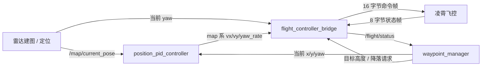

# flight_controller_bridge

`flight_controller_bridge` 是树莓派上唯一直接占用飞控串口的 ROS 2 功能包。

它把 `position_pid_controller` 输出的地图坐标系 `vx、vy、yaw_rate`，结合当前地图 yaw
转换成凌霄飞控使用的机体系速度；同时取出当前航点的数值目标高度和任务降落请求，
经过完整安全检查后编码成固定长度串口帧。它还接收飞控返回的高度/降落/故障状态，
发布给 `waypoint_manager` 使用。

本包不读取飞控姿态、不在树莓派计算 z 轴 PID、不直接控制姿态或电机，也不会自行解锁飞控。

> 树莓派侧已在 ROS 2 Jazzy 实机环境完成构建，协议单测和伪串口 launch 测试全部通过。
> 飞控副本也已接入底板串口2的新协议并通过主机 GCC 测试；仍需 Keil 编译、真实串口回环和无桨台架验证，完成前不得闭环飞行。

## 一、包在整套系统中的位置



包的职责边界：

- `position_pid_controller`：计算地图坐标系的 x/y/yaw 速度；
- `waypoint_manager`：保存/覆盖航线、选择当前航点、确认停留时间和请求降落；
- `flight_controller_bridge`：坐标旋转、安全门、单位换算、串口收发；
- 凌霄飞控：遥控授权、最终速度执行和降落；后续阶段再接入本地激光高度 z PID。

## 二、已经确认的坐标和单位

### 1. ROS 2 内部

- `map`：建图得到的固定地图坐标系；
- x、y、目标高度：m；
- yaw、yaw_rate：rad、rad/s；
- map 中从上方俯视逆时针 yaw 为正。

### 2. 凌霄飞控机体系

- x：机头前方为正；
- y：机体左侧为正；
- z：机体上方为正；
- yaw：从上方俯视逆时针为正。

PID 的地图速度不能直接交给飞控。本包使用当前地图 yaw 做：

```text
vx_body =  cos(yaw) * vx_map + sin(yaw) * vy_map
vy_body = -sin(yaw) * vx_map + cos(yaw) * vy_map
```

例如飞机机头朝 map 的 +y（yaw=+90°），PID 要求向 map +x 飞行时，命令应是机体向右，
即 `vx_body=0、vy_body<0`。自动测试已经覆盖这一方向关系。

### 3. 串口定点单位

- x/y 速度：mm/s，`int16`；
- yaw_rate：mrad/s，`int16`；
- 目标离地高度：mm，`uint16`；
- 多字节字段：大端序。

飞控端再换算成旧 `TMD_Set()` 使用的 cm/s、deg/s、cm。完整格式见
[串口协议](docs/serial_protocol.md)。

## 三、ROS 2 输入

| 话题 | 消息类型 | 用途 |
|---|---|---|
| `/pid/cmd_vel` | `geometry_msgs/msg/TwistStamped` | map 系 `vx、vy、yaw_rate` |
| `/pid/control_valid` | `std_msgs/msg/Bool` | PID 是否具备有效当前位置和计算条件 |
| `/map/current_pose` | `geometry_msgs/msg/PoseStamped` | 只取地图 yaw 完成 map -> body 旋转 |
| `/map/current_pose_valid` | `std_msgs/msg/Bool` | 定位链是否有效 |
| `/waypoint/current` | `uav_interfaces/msg/Waypoint` | 当前航点 id 和目标高度 |
| `/mission/status` | `uav_interfaces/msg/MissionStatus` | 航线、目标发送和任务完成状态 |
| `/mission/land_request` | `std_msgs/msg/Bool` | 独立降落请求 |

`/waypoint/current`、`/mission/status` 和 `/mission/land_request` 使用 reliable + transient local，
与 `waypoint_manager` 的保留消息 QoS 一致。桥节点晚启动时仍能收到当前任务快照。

航点本身没有接收超时：航点只在切换时发布是正常现象。本包会把航点 id 与周期更新的
`MissionStatus.current_waypoint_id` 对照，避免把旧航点高度配给新航点。

## 四、ROS 2 输出

### `/flight/command`

类型：`uav_interfaces/msg/FlightCommand`

这是编码串口前的调试快照：

- `header.frame_id=base_link`；
- `velocity_x、velocity_y` 已经是飞控机体系 m/s；
- `yaw_rate` 是 rad/s；
- `target_height` 是 m；
- `control_valid=false` 时飞控不得执行普通运动值；
- `land_request=true` 时速度强制为零，飞控忽略普通目标高度。

### `/flight/status`

类型：`uav_interfaces/msg/FlightStatus`

- `communication_ok`：配置时间内收到合法状态帧；
- `height_reached`：飞控本地 z PID 已进入目标高度容差；
- `land_accepted`：飞控已接受降落；
- `land_completed`：飞控确认着陆完成；
- `failsafe`：飞控报告故障保护。

当前第一阶段飞控固定返回 `height_reached=false` 和 `land_completed=false`，所以航点管理器不会凭未实现的高度闭环推进任务；合法降落请求可返回 `land_accepted=true`。

通信过期时 `communication_ok=false`，其余四项也对 ROS 2 发布为 false，防止任务管理器用旧反馈推进航点。

## 五、普通速度安全门

只有以下条件同时成立，才发送 `control_valid=true` 的普通控制帧：

1. 串口已经打开；
2. `/mission/status` 新鲜；
3. `route_valid=true`；
4. `target_sent=true`；
5. `mission_completed=false`；
6. 已收到 `/waypoint/current`，且航点 id 等于任务当前航点 id；
7. 目标高度是有限数并位于 YAML 上下限内；
8. 默认要求飞控反馈新鲜；
9. 飞控没有报告 failsafe；
10. PID 命令和 `control_valid` 都新鲜且有效；
11. PID `TwistStamped.header.frame_id` 是 `map`，所有分量都是有限数；
12. 当前位姿和位姿有效标志都新鲜且为 true；
13. 位姿 frame 是 `map`，四元数合法；
14. 平移合速度和 yaw_rate 没超过桥接包最后安全范围；
15. 换算为串口定点整数后不溢出。

任何一项失败都不会保留上一次非零命令，而是继续按 50 Hz 发送：

```text
vx=0, vy=0, yaw_rate=0, control_valid=false, land_request=false
```

飞控端还必须独立执行 200 ms 看门狗，形成树莓派和飞控两层保护。

### 为什么越界时不直接截断

PID 包已经有正常输出限幅。若它突然输出超过飞控桥设置的安全范围，通常意味着参数或数据链异常。
本包选择整帧无效并发零，而不是悄悄截断后继续飞，便于尽早发现错误。

## 六、降落安全逻辑

只有同时看到：

```text
/mission/land_request = true
route_valid = true
mission_completed = true
```

桥才接受降落。接受后会在当前航线 id 内锁存，不再依赖 PID 或地图定位，并持续发送：

```text
vx=0, vy=0, yaw_rate=0, control_valid=true, land_request=true
```

飞控报告 `land_completed=true` 后，桥停止为这条航线重复触发降落。新的 route_id 会清理旧降落锁存。

`target_height=0` 永远不是降落标志。降落期间普通目标高度由飞控明确忽略。

## 七、串口协议摘要

命令帧固定 16 字节：

```text
AA 55 | seq | flags | vx_mm/s | vy_mm/s | yaw_mrad/s | height_mm | CRC16 | 0D 0A
```

状态帧固定 8 字节：

```text
55 AA | ack_seq | flags | CRC16 | 0D 0A
```

没有版本号和帧类型号。两个方向用不同帧头，长度固定。CRC 使用
CRC16-CCITT-FALSE。字段、位标志和测试值全部写在 [serial_protocol.md](docs/serial_protocol.md)。
树莓派还会检查 ACK 是否处于最近命令窗口，CRC正确但序号过旧/超前的状态帧不会恢复通信。

## 八、目录结构

```text
flight_controller_bridge/
├── CMakeLists.txt
├── package.xml
├── README.md
├── config/
│   └── flight_controller_bridge_params.yaml
├── docs/
│   ├── old_flight_controller_findings.md
│   └── serial_protocol.md
├── include/flight_controller_bridge/
│   ├── coordinates.hpp
│   └── protocol.hpp
├── launch/
│   └── flight_controller_bridge.launch.py
├── src/
│   ├── flight_controller_bridge_node.cpp
│   └── protocol.cpp
├── test/
│   ├── test_bridge_launch.py
│   └── test_protocol_and_coordinates.cpp
└── tools/
    └── fake_flight_controller.py
```

## 九、放入树莓派工作空间

目标位置：

```text
/home/ljz/ros2_ws/src/flight_controller_bridge
```

解压后必须保证 `package.xml` 直接位于上面的目录内，不能多套一层同名文件夹。

先确认依赖包已经存在：

```bash
ls /home/ljz/ros2_ws/src/uav_interfaces/package.xml
ls /home/ljz/ros2_ws/src/flight_controller_bridge/package.xml
```

构建：

```bash
cd /home/ljz/ros2_ws
source /opt/ros/jazzy/setup.bash
colcon build --symlink-install --packages-select uav_interfaces flight_controller_bridge
source /home/ljz/ros2_ws/install/setup.bash
```

运行自动测试：

```bash
cd /home/ljz/ros2_ws
colcon test --packages-select flight_controller_bridge --event-handlers console_direct+
colcon test-result --verbose
```

自动测试包括：

- CRC16 标准检查值；
- 命令帧字节顺序和负数大端编码；
- 状态帧编解码与 CRC 损坏拒绝；
- 噪声、错位、坏帧后的重新同步；
- map -> 飞控机体系旋转；
- Linux 伪终端上的完整 ROS 话题—串口—状态回传链路。

## 十、修改参数

直接编辑：

```text
/home/ljz/ros2_ws/src/flight_controller_bridge/config/flight_controller_bridge_params.yaml
```

最先需要确认的是：

```yaml
serial_device: "/dev/ttyUSB0"   # USB-TTL 常见值
# serial_device: "/dev/serial0" # 树莓派 GPIO UART 推荐稳定别名
baud_rate: 115200
```

雷达已经使用 `/dev/ttyACM0` 时，不要把飞控桥也配置到同一设备。

查看实际设备：

```bash
ls -l /dev/serial* 2>/dev/null
ls -l /dev/ttyUSB* /dev/ttyACM* 2>/dev/null
```

若提示 `Permission denied`：

```bash
sudo usermod -aG dialout ljz
```

执行后需要注销并重新登录或重启，组权限才会完整生效。

## 十一、先用伪飞控测试，禁止直接装桨

### 终端 1：启动伪飞控

```bash
source /opt/ros/jazzy/setup.bash
source /home/ljz/ros2_ws/install/setup.bash
ros2 run flight_controller_bridge fake_flight_controller.py
```

它会显示一个临时路径，例如 `/dev/pts/5`。

### 终端 2：把桥临时连到伪串口

```bash
source /opt/ros/jazzy/setup.bash
source /home/ljz/ros2_ws/install/setup.bash
ros2 run flight_controller_bridge flight_controller_bridge_node --ros-args \
  --params-file /home/ljz/ros2_ws/src/flight_controller_bridge/config/flight_controller_bridge_params.yaml \
  -p serial_device:=/dev/pts/5
```

只启动这两个程序、没有 PID/定位/航线时，正确现象是：

```text
valid=false
vx=0, vy=0, yaw_rate=0
communication_ok=true
```

这证明“串口通信正常”不等于“允许飞行”，安全门仍会阻止缺少上游数据的控制。

### 再启动现有软件链

按已经验证过的方式启动：

1. 雷达与建图/定位；
2. `map_coordinate_provider`；
3. `position_pid_controller`；
4. `waypoint_manager`；
5. 地面站下发合法航线。

桥本身可以更早启动；在所有条件满足前只发无效零速帧。

观察：

```bash
ros2 topic echo /flight/command uav_interfaces/msg/FlightCommand
ros2 topic echo /flight/status uav_interfaces/msg/FlightStatus
ros2 topic hz /flight/status
```

移动雷达/机体并改变 yaw，伪飞控终端中显示的是旋转后的机体系速度，而不是 map 原值。

## 十二、连接真实飞控前的检查顺序

必须拆桨或切断电机动力，且让你能随时关闭遥控授权开关。

1. 断电检查 TX/RX 交叉、共地和 3.3 V 电平；
2. 只连接串口，不解锁，确认双方都能收合法帧；
3. 不启动 PID/定位，确认飞控 TMD 四轴始终为零；
4. 人为发送 CRC 错误和半帧，确认飞控不更新命令；
5. 中断树莓派发送超过 200 ms，确认飞控自动清零；
6. 关闭遥控授权开关，确认树莓派即使发 valid=true 也不能接管；
7. 无桨验证 x 前、y 左、yaw 逆时针的符号；
8. 当前只验证数值目标高度被正确保存；待后续完成 z PID 后再确认 z 正方向；
9. 单独触发降落，确认普通目标高度被忽略；
10. 完成低速、限位、系留测试后才考虑装桨。

当前旧飞控代码不满足上述全部条件，具体差异见
[old_flight_controller_findings.md](docs/old_flight_controller_findings.md)。

## 十三、正常启动

飞控端适配和无桨测试全部完成后：

```bash
source /opt/ros/jazzy/setup.bash
source /home/ljz/ros2_ws/install/setup.bash
ros2 launch flight_controller_bridge flight_controller_bridge.launch.py
```

比赛开机自动启动不会通过在每个终端手工 `source` 实现。按照此前约定，后续制作总启动包时会：

- 统一启动雷达/建图、坐标提供、PID、航点管理和飞控桥；
- 在启动进程内部加载 ROS 与工作空间环境；
- 配合 systemd 设置开机启动、异常重启和日志；
- 仍保持“必须等待地面站正式航线”的比赛安全条件。

本包当前不单独创建 systemd，避免多个包各自抢启动顺序和串口。

## 十四、无需 RViz

建图和定位节点在 ROS 2 话题中运行，不依赖 RViz。RViz 只是可视化界面。
比赛时不启动 RViz 不影响本包接收 `/map/current_pose`，还可以降低图形负担。

## 十五、常见问题

### 1. 一直显示“串口未连接”

检查 YAML 设备名、USB-TTL 是否枚举、`dialout` 权限、是否有另一个程序占用同一串口。

### 2. `communication_ok=true`，但 `control_valid=false`

这是正常的分层结果。日志中的“安全门=”会指出具体原因，常见是：

- 地面站尚未下发航线；
- waypoint_manager 还没有把目标发给 PID；
- PID 或当前位置无效/过期；
- waypoint id 与 mission id 不一致；
- 飞控报告 failsafe；
- 速度或高度超出桥的 YAML 安全范围。

### 3. 机头转过后速度方向错误

同时检查 `/map/current_pose` 的 yaw 正方向、四元数、飞控 x/y 正方向以及是否把 map 速度重复旋转。
本包只旋转一次，PID 必须继续输出 map 坐标系速度。

### 4. 高度始终不到达

本包只发送数值目标高度。检查飞控是否按 mm 解码并换算到 cm、`HIGH` 的实际单位和正方向、
z PID 输出符号、容差迟滞及状态帧 bit0。不要用 `target_height=0` 代替屏蔽或降落。

### 5. 航点完成后没有降落

依次查看：

```bash
ros2 topic echo /mission/status uav_interfaces/msg/MissionStatus
ros2 topic echo /mission/land_request std_msgs/msg/Bool
ros2 topic echo /flight/command uav_interfaces/msg/FlightCommand
ros2 topic echo /flight/status uav_interfaces/msg/FlightStatus
```

应先看到 `mission_completed=true` 和 `land_request=true`，再看到桥命令
`control_valid=true、land_request=true`，最后看到飞控 `land_accepted/land_completed=true`。

## 十六、真机默认值说明

YAML 中的速度范围、超时和频率是联调初值，不是已经为具体飞机完成标定的飞行参数。
尤其是飞控 z PID、激光高度噪声、到达迟滞、降落判定和遥控退出逻辑，都必须在飞控端改造后独立验证。
